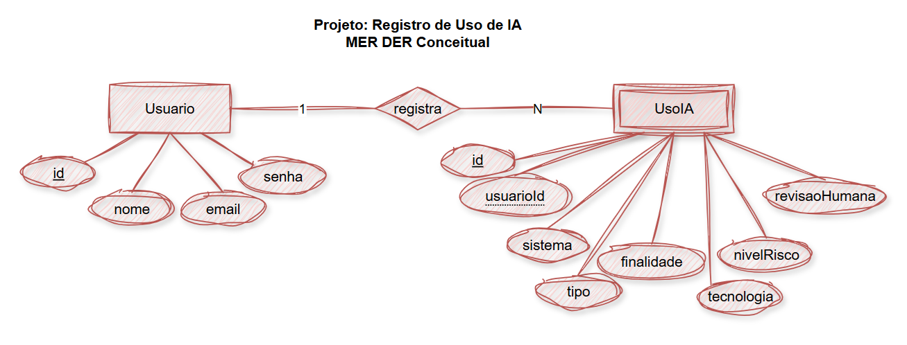
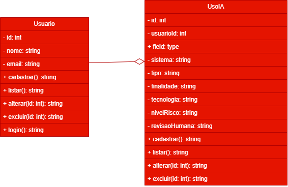
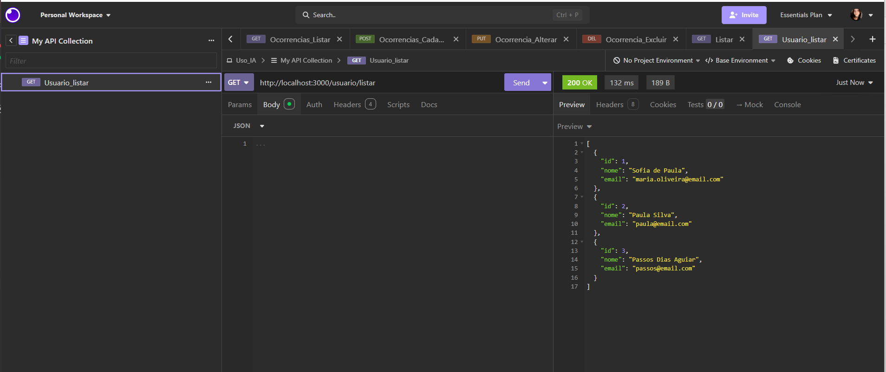
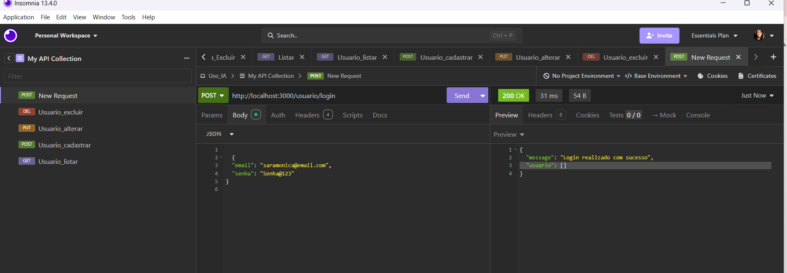
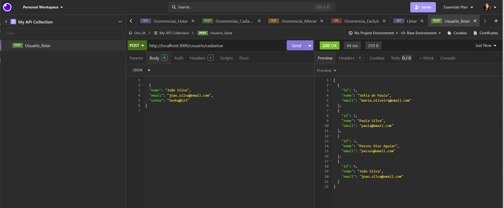
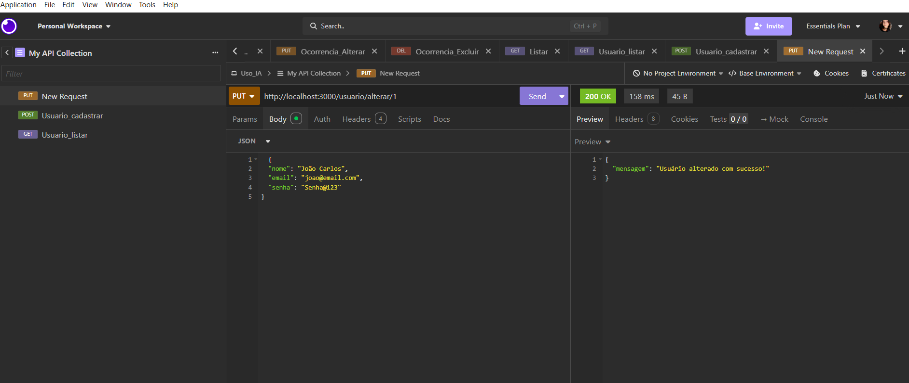
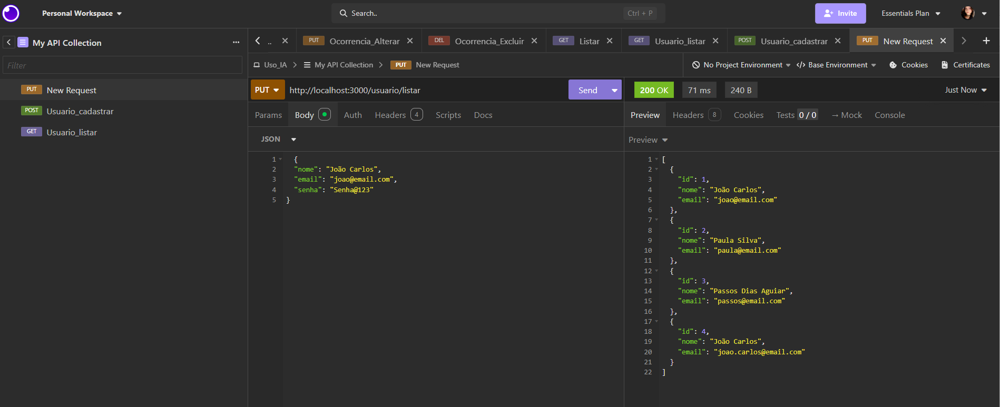
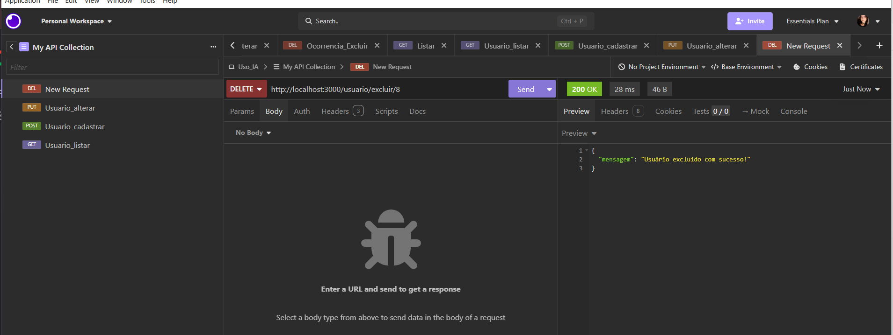
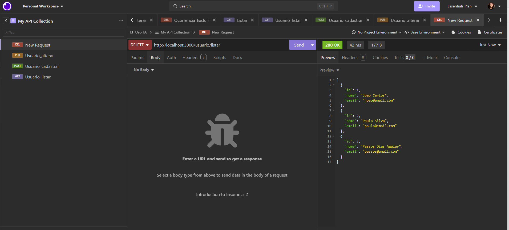

# Gestão de Resíduos Sólidos

 ## Resíduos Sólidos - Back-End
 Backend para o Registramento sobre o Uso de IA(inteligência Artificial). O sistema permite cadastrar, listar, atualizar e excluir usuários e ocorrências.
 
 ---

## MER & DER conceitual e lógico
---

---
## UML - DC (Diagrama de Classe)
---

---

## Tecnologias Utilizadas
---
 - Node.js
 - Java Script
 - Insomnia
 - XAMPP
 - MariaDB / MySQL
 - VS Code
 ---

 ## Instruções para testar
 ---
 1 - Use os códigos no repositório acima, inicie o servidor no terminal (CMD) com as dependências:

 - npm init -y
 - npm i express cors
 - npm install mysql2
 - npm run dev

2 - Inicie uma nova página no Insomnia, usando o link do servidor, e teste os códigos.

---

## Insomnia
---
 - Listar Usuários

 - Login Usuários

 

  - Cadastrar Usuários

 - Alterar Usuários 

 

 

  - Excluir Usuários 

 - Listar Uso IAs

 

  - Cadastrar Uso IAs 

   - Alterar Uso IAs

 - Excluir Uso IAs 

 

 

 ---
